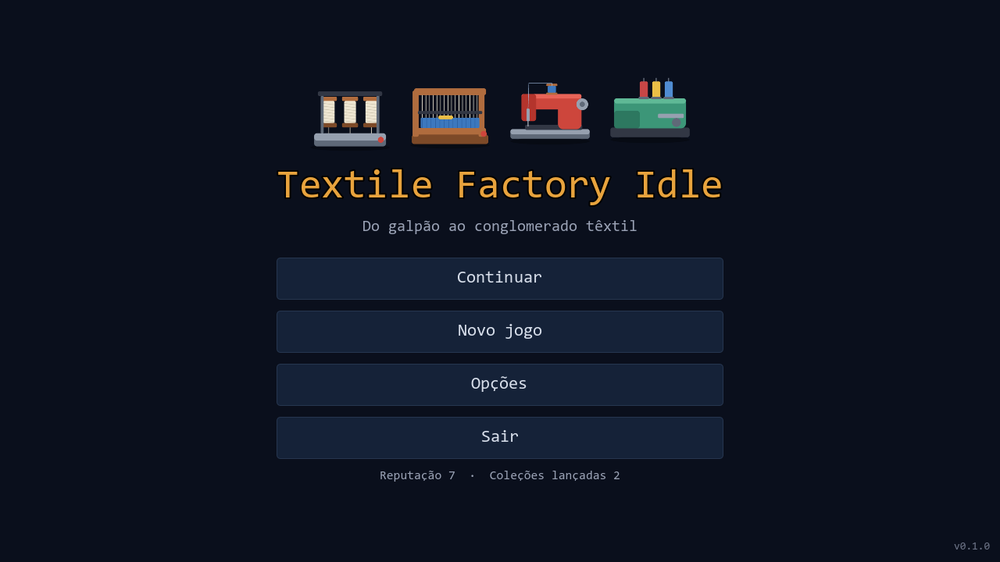
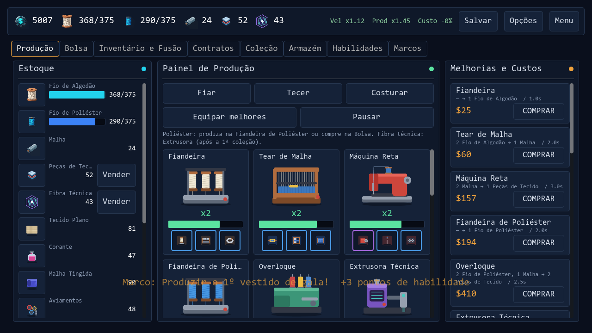
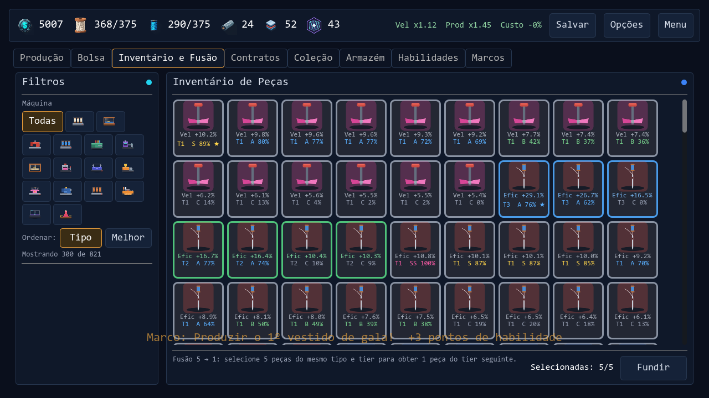
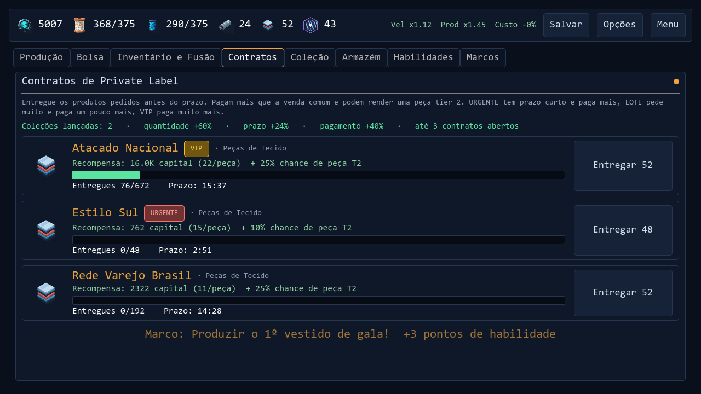
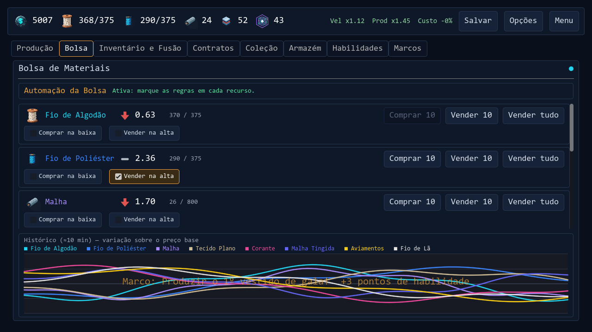
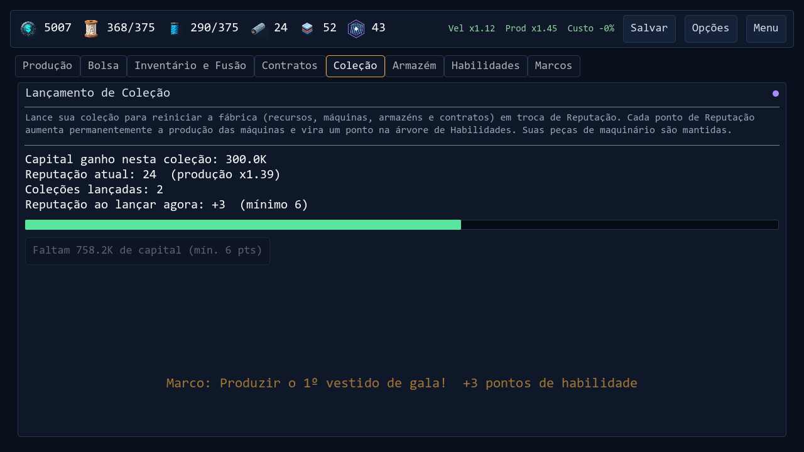
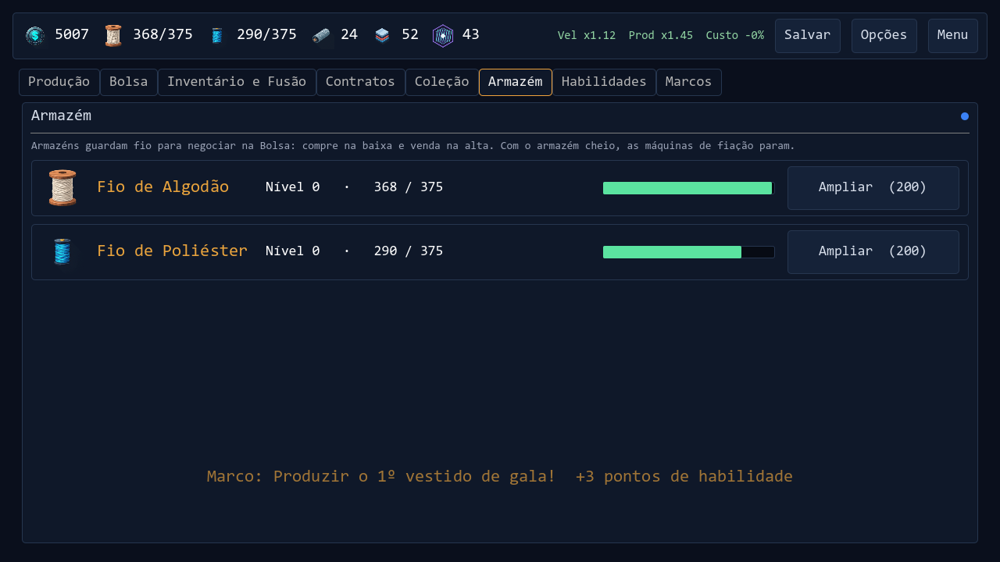
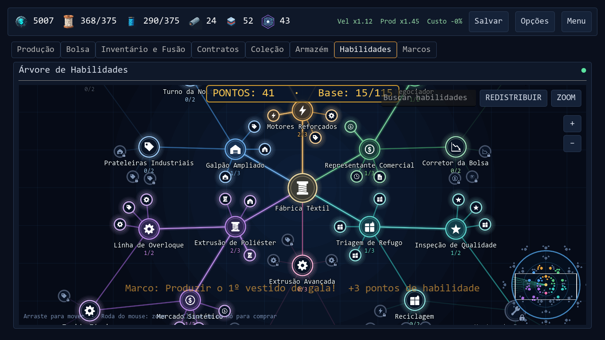
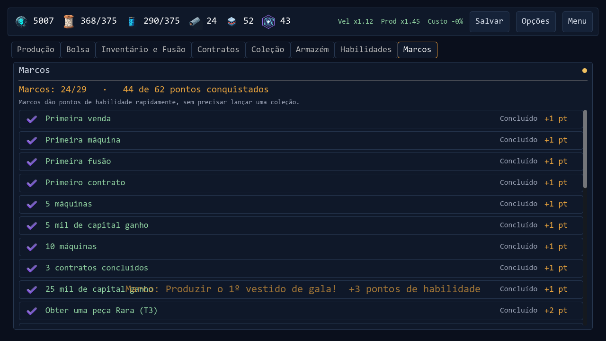

<div align="center">



# Textile Factory Idle

**Do galpão ao conglomerado têxtil.** Um idle de gestão de fábrica com loot de peças de maquinário, fusão 5x1 garantida, contratos, Bolsa de materiais e prestígio por lançamento de coleção.

[](https://github.com/Thiago-Bilangieri/textile-factory-idle-releases/releases/latest)

</div>

---

## Índice

1. [Instalação e atualização](#1-instalação-e-atualização)
2. [Primeiros passos (tutorial)](#2-primeiros-passos-tutorial)
3. [As telas do jogo](#3-as-telas-do-jogo)
4. [Máquinas e cadeia de produção](#4-máquinas-e-cadeia-de-produção)
5. [Drops: caixas de refugo e peças](#5-drops-caixas-de-refugo-e-peças)
6. [Fusão e qualidade](#6-fusão-e-qualidade)
7. [Contratos](#7-contratos)
8. [Bolsa de materiais](#8-bolsa-de-materiais)
9. [Lançamento de coleção (prestígio)](#9-lançamento-de-coleção-prestígio)
10. [Árvore de habilidades e marcos](#10-árvore-de-habilidades-e-marcos)
11. [Dicas](#11-dicas)

> Todos os números deste guia vêm de `data/balance.json` e `data/habilidades.json`. Se o balanceamento mudar, as tabelas mudam junto.

---

## 1. Instalação e atualização

1. Baixe o `.zip` da [última versão](https://github.com/Thiago-Bilangieri/textile-factory-idle-releases/releases/latest) e extraia o `TextileFactoryIdle.exe` numa pasta onde você possa gravar (Documentos, Desktop). **Não use `Program Files`.**
2. Execute. Se o Windows mostrar o aviso do SmartScreen (o executável não é assinado), clique em **Mais informações → Executar assim mesmo**.
3. **Atualização automática:** ao abrir o jogo, ele consulta a última versão. Se houver uma mais nova, baixa, troca o `.exe` sozinho e reabre. Sem internet, o jogo abre normalmente.

O jogo salva sozinho a cada 60 s (`Salvar` no topo força o save). Idiomas: português, inglês e espanhol (**Opções → Idioma**). `F11` alterna tela cheia.

---

## 2. Primeiros passos (tutorial)

O jogo guia você em 7 passos (caixa no rodapé; dá para pular):

| # | O que fazer | Por quê |
|---|---|---|
| 1 | Clique em **Fiar** 3 vezes | gera fio de algodão |
| 2 | Clique em **Tecer** | 2 fios viram 1 malha |
| 3 | Clique em **Costurar** | 2 malhas viram 1 peça de tecido |
| 4 | **Venda** as peças no painel Estoque | gera capital |
| 5 | **Compre sua primeira máquina** | ela produz sozinha |
| 6 | Aba **Contratos**: entregue 5 peças à Boutique Aurora | 1º contrato |
| 7 | Aba **Inventário e Fusão**: selecione as 5 correias iniciais e **Fundir** | 1ª fusão |

Depois disso o ciclo é: **comprar mais máquinas → vender/entregar contratos → pegar peças nas caixas de refugo → fundir → lançar coleção → repetir mais forte.**

---

## 3. As telas do jogo

### Produção


- **Topo:** capital, fios (com limite do armazém), malha, peças de tecido, fibra técnica e os bônus globais (`Vel`, `Prod`, `Custo`).
- **Esquerda (Estoque):** tudo o que você tem; `Vender` converte produtos finais em capital.
- **Centro:** botões manuais (Fiar, Tecer, Costurar), `Equipar melhores` e `Pausar`, e o card de cada máquina com a barra de ciclo e os **3 slots de peça** (velocidade, produção, custo).
- **Direita:** comprar máquinas. O custo sobe **17% por unidade** comprada.

### Inventário e Fusão


Cada peça mostra o stat (`Vel`, `Efic` ou `Custo`), o **tier** (T1–T5) e o **grau** com a qualidade (`S 89%`). Borda colorida = tier. Clique para selecionar 5 iguais e `Fundir`. Botão direito: equipar/desequipar ou bloquear (⭐) a peça.

### Contratos


### Bolsa


### Coleção (prestígio)


### Armazém


### Habilidades


### Marcos


---

## 4. Máquinas e cadeia de produção

Cada máquina converte insumos em produto a cada intervalo. A **ordem de desbloqueio** é a da tabela; as últimas exigem coleções lançadas.

| Máquina | Custo base | Ciclo | Consome | Produz | Exige |
|---|---:|---:|---|---|---|
| Fiandeira | $25 | 1,0 s | — | 1 fio de algodão | — |
| Tear de Malha | $60 | 2,0 s | 2 fio de algodão | 1 malha | — |
| Máquina Reta | $150 | 3,0 s | 2 malha | 1 peça de tecido | — |
| Fiandeira de Poliéster | $180 | 2,0 s | — | 1 fio de poliéster | — |
| Overloque | $400 | 2,5 s | 2 fio de poliéster + 1 malha | 2 peças de tecido | — |
| Tear Plano | $900 | 4,0 s | 3 fio de algodão | 1 tecido plano | — |
| Reator de Corantes | $1.500 | 3,0 s | — | 1 corante | — |
| Tinturaria | $2.500 | 3,0 s | 1 malha + 1 corante | 1 malha tingida | — |
| Injetora de Aviamentos | $3.500 | 3,0 s | 1 fio de poliéster | 2 aviamentos | — |
| Estamparia | $4.000 | 3,5 s | 2 malha tingida | 1 camiseta estampada | — |
| Confecção de Jeans | $8.000 | 4,0 s | 2 tecido plano + 1 aviamentos | 1 calça jeans | — |
| Extrusora Técnica | $12.000 | 4,0 s | 3 fio de poliéster + 1 malha | 1 fibra técnica | 1 coleção |
| Fiandeira de Lã | $25.000 | 2,0 s | — | 1 fio de lã | 2 coleções |
| Malharia de Lã | $40.000 | 4,0 s | 2 fio de lã + 1 malha | 1 casaco de lã | 2 coleções |
| Costura Técnica | $90.000 | 5,0 s | 2 fibra técnica + 1 tecido plano + 2 aviamentos | 1 traje técnico | 3 coleções |
| Atelier de Alta-Costura | $150.000 | 6,0 s | 2 malha tingida + 1 tecido plano + 1 fio de lã | 1 vestido de gala | 4 coleções |

### Preço de venda dos produtos finais

| Produto | Valor base |
|---|---:|
| Peça de tecido | $5 |
| Fibra técnica | $16 |
| Camiseta estampada | $14 |
| Calça jeans | $22 |
| Casaco de lã | $30 |
| Traje técnico | $65 |
| Vestido de gala | $90 |

As habilidades de preço aumentam esses valores. Fios e demais intermediários têm limite de estoque (armazém) e são negociados na [Bolsa](#8-bolsa-de-materiais).

---

## 5. Drops: caixas de refugo e peças

Enquanto trabalham, as máquinas podem soltar uma **caixa de refugo** com uma peça de maquinário.

| Parâmetro | Valor |
|---|---|
| Chance de caixa | **0,02% por segundo de trabalho, por ciclo executado** (`0,0002 × ciclo` por ciclo; igual para todas as máquinas, rápidas ou lentas) |
| Caixas por hora, por máquina | **≈ 0,72** (uma a cada ~83 min) |
| Qual peça sai | sempre uma das **3 peças da máquina que a produziu**, com a mesma chance (1/3 cada) |
| Tier da peça | **90% T1** · **10% T2** (T3+ só por fusão) |
| Bônus de habilidade | `drop_pct` (até +61%) e `tier2_chance_pct` (até +10 pontos) |

Ter **mais unidades** da mesma máquina multiplica as caixas: 10 Fiandeiras ≈ 7,2 caixas/hora.

### Peças por máquina (cada uma só vale na máquina onde está equipada)

| Máquina | Velocidade | Produção (eficiência) | Custo de compra |
|---|---|---|---|
| Fiandeira | Fuso de Alta Rotação | Rolo de Estiragem | Anel de Fiação |
| Tear de Malha | Lançadeira | Pente do Tear | Cilindro de Agulhas |
| Máquina Reta | Motor da Reta | Agulha Industrial | Correia de Transmissão |
| Fiandeira de Poliéster | Bomba de Fusão | Bico da Fieira | Resistência Térmica |
| Overloque | Looper | Faca de Corte | Guia de Tecido |
| Extrusora Técnica | Rosca Extrusora | Matriz de Extrusão | Aquecedor de Zona |
| Tear Plano | Navete de Alta Velocidade | Liço de Tecelagem | Rolo de Urdume |
| Reator de Corantes | Agitador de Pós | Tanque de Mistura | Válvula Dosadora |
| Tinturaria | Tambor Rotativo | Tina de Tingimento | Bomba de Circulação |
| Injetora de Aviamentos | Pistão Hidráulico | Molde de Botões | Bico Injetor |
| Estamparia | Rodo de Serigrafia | Tela de Serigrafia | Esteira de Secagem |
| Confecção de Jeans | Motor Servo Reforçado | Agulha Denim | Bobina de Fio Grosso |
| Fiandeira de Lã | Carda de Lã | Pente de Lã | Rolo Alimentador |
| Malharia de Lã | Carro de Malharia | Agulha de Malharia | Came de Padrão |
| Costura Técnica | Cortador a Laser | Soldador Ultrassônico | Prensa Térmica |
| Atelier | Manequim Articulado | Tesoura de Alfaiate | Ferro a Vapor |

São **48 peças** no total. O stat de custo de compra tem teto de **50%** de redução.

### Probabilidade da peça que cai numa caixa

| Resultado | Chance por caixa |
|---|---:|
| Peça T1 | 90% |
| Peça T2 | 10% |
| Qualquer peça T1 com grau **SS** | 4,5% |
| Qualquer peça T2 com grau **SS** | 0,5% |

(Os graus estão na seção seguinte.)

### Quantas caixas para chegar em cada tier

Fusão custa 5 peças do mesmo tipo e tier. Em "T1 equivalentes" (uma T2 vale 5), cada caixa rende em média **0,9 + 0,1×5 = 1,4**.

| Meta (1 peça) | T1 equivalentes | Caixas dessa peça (média) | Caixas da máquina* |
|---|---:|---:|---:|
| T2 | 5 | ~4 | ~11 |
| T3 | 25 | ~18 | ~54 |
| T4 | 125 | ~89 | ~268 |
| T5 | 625 | ~446 | ~1.339 |

\* Como a caixa sorteia 1 entre 3 peças da máquina, para uma peça específica a máquina precisa soltar ~3x mais caixas. Os números são sem habilidades; o drop da árvore reduz esse tempo. Uma máquina solta ~0,72 caixas/hora (multiplique pelo número de unidades).

---

## 6. Fusão e qualidade

**5 peças iguais (mesmo tipo e tier) → 1 peça do tier seguinte. 100% garantido, sem chance de falha.** Peças equipadas, listadas ou bloqueadas não entram na fusão.

O valor do stat é:

```
stat = base do tier × (1 + qualidade / 100)       qualidade: 0 a 100
```

### Base por tier

| Tier | Nome | Base (qualidade 0) | Máximo (qualidade 100) |
|---|---|---:|---:|
| T1 | Comum | 5,4% | 10,8% |
| T2 | Incomum | 9,4% | 18,8% |
| T3 | Raro | 16,5% | 33,0% |
| T4 | Épico | 28,75% | 57,5% |
| T5 | Lendário | 50,0% | 100,0% |

O máximo de um tier fica até 15% acima da base do seguinte, então uma fusão quase sempre vale a pena.

### Graus de qualidade (rate de cada rolagem)

Toda peça nova (caixa **ou** fusão) rola o grau pela tabela abaixo e depois um valor uniforme dentro da faixa.

| Grau | Qualidade | Chance | Chance acumulada (≥ grau) |
|:---:|:---:|---:|---:|
| C | 0–20 | **35%** | 100% |
| B | 21–60 | **30%** | 65% |
| A | 61–80 | **20%** | 35% |
| S | 81–90 | **10%** | 15% |
| SS | 91–100 | **5%** | 5% |

Qualidade média sem habilidades: **≈ 43**. A habilidade `qualidade_pct` (Maestria, até 66%) dá chance de **rolar duas vezes e ficar com a melhor**, subindo a média para ≈ 55.

### Exemplo: a mesma peça nos graus extremos

| Peça | Pior (C 0%) | Melhor (SS 100%) |
|---|---:|---:|
| T1 | +5,4% | +10,8% |
| T2 | +9,4% | +18,8% |
| T3 | +16,5% | +33,0% |
| T4 | +28,75% | +57,5% |
| T5 | +50,0% | +100,0% |

Dica: use `Equipar melhores` para preencher os 3 slots de cada máquina com as melhores peças.

---

## 7. Contratos

Clientes (private label) pedem uma quantidade de um produto num prazo e **pagam acima do preço comum**. Podem render **1 peça T2** como bônus.

| Regra | Valor |
|---|---|
| Vagas de contrato | 3 (+1 a cada 4 coleções, até +3) |
| Novo contrato | a cada 45 s |
| Multa por expirar | nenhuma |
| Clientes | 34, de 4 portes (nível 1 a 4), cobrindo todos os produtos finais |

### Variantes sorteadas

| Variante | Quantidade | Prazo | Pagamento | Chance | Exige |
|---|---:|---:|---:|---:|---|
| **URGENTE** | ×0,6 | ×0,5 | ×1,5 | 16% | — |
| **LOTE** | ×2,5 | ×2,0 | ×1,12 | 12% | 1 coleção |
| **VIP** | ×1,4 | ×1,0 | ×1,75 | 8% | 2 coleções |

### Escala por coleção lançada

| Atributo | Por coleção |
|---|---:|
| Quantidade | +30% |
| Pagamento | +20% |
| Prazo | +12% |
| Chance de clientes de porte maior | +0,45 de nível-alvo |

### Alguns clientes (peças de tecido)

| Cliente | Nível | Peças | Prazo | Preço/peça | Chance de T2 |
|---|:---:|---:|---:|---:|---:|
| Boutique Aurora (tutorial) | — | 5 | 25 min | $8,0 | 0% |
| Feira Livre | 1 | 35 | 5 min | $6,0 | 0% |
| Boutique Express | 1 | 10 | 2 min | $8,5 | 0% |
| Estilo Sul | 2 | 50 | 7 min | $7,0 | 10% |
| Rede Varejo Brasil | 3 | 120 | 12 min | $8,0 | 25% |
| Atacado Nacional (2 col.) | 4 | 300 | 25 min | $9,0 | 25% |
| Exportação Mercosul (3 col.) | 4 | 600 | 40 min | $10,0 | 30% |

Os contratos de **fibra técnica, camiseta, jeans, casaco, traje técnico e vestido** só aparecem se você tiver a máquina (ou as coleções) necessária. A chance de peça T2 do contrato **não escala** com as coleções.

---

## 8. Bolsa de materiais

Compre barato, venda caro e automatize. Oito materiais negociáveis, com preço **cíclico** (sobe e desce em ondas) e taxa (spread) de **5%**.

| Material | Preço base | Período do ciclo | Variação (±) |
|---|---:|---:|---:|
| Fio de algodão | $1,00 | 10 min | 45% |
| Fio de poliéster | $2,20 | 14 min | 40% |
| Malha | $2,40 | 8 min | 38% |
| Tecido plano | $3,60 | 11 min | 36% |
| Corante | $1,60 | 13 min | 45% |
| Malha tingida | $4,40 | 9 min | 35% |
| Aviamentos | $1,40 | 15 min | 42% |
| Fio de lã | $3,00 | 12 min | 40% |

- Sinal de **alta** quando o preço está 25% acima da base; **baixa** quando 25% abaixo.
- O preço base é ≈ 1,2× o custo dos insumos, para a máquina continuar compensando.
- **Limite de compra:** só dá para comprar até o estoque de referência (capacidade do armazém, ou 400 +50% por coleção lançada). Isso impede lucro infinito.
- **Automação** (por material): compra na baixa e vende na alta. Desbloqueio de **$3.000**; verifica a cada 2 s, reserva 20% do estoque na venda e gasta no máximo 50% do capital.
- Um material só aparece na Bolsa depois de ter sido produzido ou obtido uma vez.

---

## 9. Lançamento de coleção (prestígio)

Reinicia **recursos, máquinas, armazéns e contratos**. Mantém **peças, habilidades e marcos**.

```
reputação ao lançar = floor( (capital ganho na run / 12.000) ^ 0,4 )
bônus de produção   = 1 + 0,08 × √reputação
```

Cada ponto de reputação também vira **1 ponto de habilidade**.

| Coleções já lançadas | Reputação mínima | Capital ganho necessário (aprox.) |
|:---:|:---:|---:|
| 0 | 3 | ~187 mil |
| 1 | 4 | ~384 mil |
| 2–3 | 6 | ~1,06 milhão |
| 4–8 | 10 | ~3,8 milhões |
| 9+ | 15 | ~10,5 milhões |

### Desbloqueios por coleção

| Coleções | Libera |
|:---:|---|
| 1 | Extrusora Técnica, contratos de fibra técnica, variante LOTE |
| 2 | Fiandeira e Malharia de Lã, variante VIP |
| 3 | Costura Técnica |
| 4 | Atelier de Alta-Costura |

### Progresso offline

O jogo continua produzindo enquanto está fechado: **até 8 h a 50% da eficiência** (mínimo 60 s de ausência). Habilidades de Logística aumentam o limite de horas e a eficiência.

---

## 10. Árvore de habilidades e marcos

Mapa radial com **6 ramos**, **91 nós** e **278 pontos**, mais a camada de **Maestria** (36 nós extras, 516 pontos) liberada só com a árvore base completa.

| Ramo | Foco |
|---|---|
| Produção | velocidade, produção e custo de máquinas |
| Comércio | preço de venda, contratos, redução do spread da Bolsa, automação grátis |
| Engenharia | **drops de caixa**, chance de T2, bônus de peças |
| Fibras Sintéticas | poliéster, Overloque |
| Fibras Técnicas | Extrusora, fibra técnica, contratos técnicos |
| Logística | capacidade do armazém, tempo e eficiência offline |

Efeitos que mexem nos drops:

| Efeito | Soma total na árvore | Para que serve |
|---|---:|---|
| `drop_pct` | +61% | mais caixas de refugo |
| `tier2_chance_pct` | +10 pontos | caixa vir em T2 (10% → 20%) |
| `pecas_bonus_pct` | +55% | força das peças equipadas |
| `qualidade_pct` | 66% (Maestria) | chance de rolar a qualidade 2× e ficar com a melhor |

### Marcos (29 metas, 62 pontos de habilidade)

Recompensas sem precisar lançar coleção:

| Marco | Pontos |
|---|---:|
| Primeira venda, primeira máquina, primeira fusão, primeiro contrato, 5 e 10 máquinas, 5 mil de capital, 3 contratos, 25 mil de capital | 1 cada |
| Peça Rara (T3), 25 máquinas, 1ª coleção, 250 mil de capital, 10 contratos | 2 cada |
| Peça Épica (T4), 1 milhão de capital, 50 contratos, 50 fusões, 25 de reputação | 3 cada |
| 10 milhões de capital | 4 |
| **Peça Lendária (T5)** | **5** |
| Primeira camiseta, jeans, casaco, traje e vestido | 1 a 3 |

---

## 11. Dicas

1. **Compre máquinas baratas em quantidade** no começo: o drop e a produção crescem linearmente com as unidades.
2. **Funda sempre** as peças T1 repetidas: a fusão é garantida e a próxima rolagem pode vir em grau alto.
3. **Guarde e bloqueie (⭐)** peças boas que você quer manter.
4. **Contratos URGENTE e VIP pagam muito mais**; veja o prazo antes de aceitar.
5. **Automatize a Bolsa** assim que tiver $3.000.
6. Lance a coleção quando o ganho de reputação desacelerar: os pontos de habilidade são o que mais acelera a próxima run.
7. Comece a árvore pelo ramo de **Engenharia** se o seu foco for farmar peças T4/T5.

